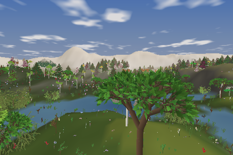

## Built with Flow

Whole programs written in Flow, outside this repository.

<article class="demo-collection-card">
  
  

    
Systems through time

    <h3><a href="https://godofecht.github.io/lsystem-ecosystem/">L-System Ecosystem</a></h3>
    
Plants grown from L-systems, the insects that pollinate them, and the creatures that eat their fruit, whose bodies are grown from L-systems too. Each lives, breeds and dies, and passes its genes on with small changes.

    
first persongfx · native + WASM

    <a class="demo-collection-open" href="https://godofecht.github.io/lsystem-ecosystem/">Play in the browser →</a>
  

</article>

